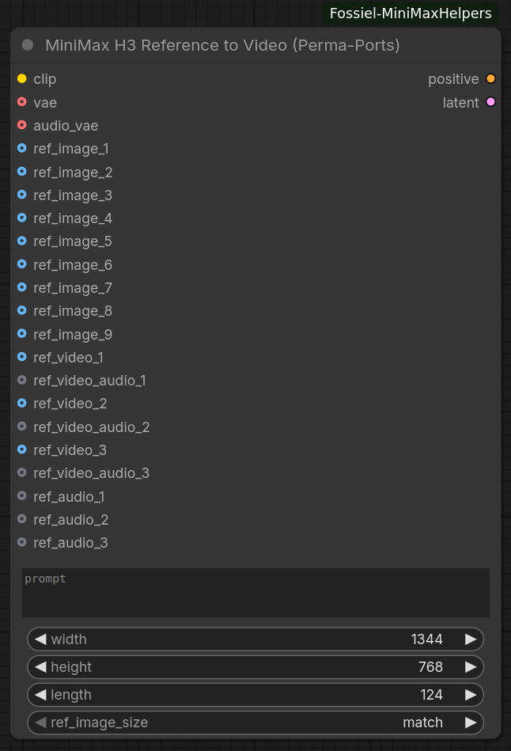

# ComfyUI-Fossiel-MiniMaxHelpers

ComfyUI-Fossiel-MiniMaxHelpers is a small suite of custom nodes designed specifically for MiniMax H3 workflows in ComfyUI. These nodes have been developed for personal use but maybe you’ll find them useful as well.

## Nodes (Listed Alphabetically)

### MiniMax H3 Reference to Video (Perma-Ports)

Classic ComfyUI version of the MiniMax H3 Reference-to-Video node with **permanent optional inputs** (no Autogrow).

This node prepares positive conditioning and an empty audio-visual latent for MiniMax H3 generation, using up to:

- **9** reference images  
- **3** reference videos  
- **3** paired video soundtracks  
- **3** standalone reference audios  

All optional ports are always visible, making it easy to wire complex multi-reference workflows without dynamically growing the node.

#### Specifications

**Required Inputs:**
1. **clip** – CLIP / text encoder (MiniMax-compatible)
2. **prompt** – Text prompt (supports dynamic prompts)

**Parameters:**
1. **width** / **height** – Generation resolution (default 1344×768, step 32)
2. **length** – Frame count at 24 fps (default 124 ≈ 5 s). Automatically snapped to the MiniMax grid (`17k + 5`)
3. **ref_image_size**  
   - `match` – Scale reference images to the generation area (downscale only)  
   - `max` – Scale to 2048 short edge (better identity preservation, slower)

**Optional Inputs:**
1. **vae** – Video VAE (required for encoding reference images/videos into latents)
2. **audio_vae** – Audio VAE (required for encoding reference audio)
3. **ref_image_1 … ref_image_9** – Reference images
4. **ref_video_1 … ref_video_3** – Reference video batches (IMAGE)
5. **ref_video_audio_1 … ref_video_audio_3** – Optional soundtrack paired with each reference video
6. **ref_audio_1 … ref_audio_3** – Standalone reference audios

**Outputs:**
1. **positive** – Conditioning with MiniMax reference blocks attached
2. **latent** – Empty nested AV latent ready for sampling (video + audio)

**Notes:**
- Reference videos must contain at least 5 frames.
- Video frame counts are automatically trimmed to the nearest valid MiniMax length (`… 5, 22, 39, 56, 73, 90, 107, 124 …`).
- Canvas size for reference videos is adapted to stay within MiniMax’s recommended pixel budget while remaining divisible by 32.
- When a soundtrack is provided with a reference video, it is labelled and encoded before the video so the model can associate the audio correctly.
- The node does not alter the original MiniMax H3 Reference-to-Video behaviour — it only makes every reference slot permanently visible.

---

### Installation Instructions
1. Clone or download this repository to your local machine.
2. Copy the repository folder to your ComfyUI custom nodes directory: `ComfyUI/custom_nodes/`
3. Restart ComfyUI to load the Fossiel MiniMax Helpers nodes.
4. Find the nodes in ComfyUI under the category **Fossiel/MiniMax**.

---

## History
2026/10/24 – Launched with MiniMax H3 Reference to Video (Perma-Ports) node.

---

## Credits  
Developed with help from Grok  
All the developers who make tools available to everyone using local AI  
Model developers for supplying fantastic open source models, free of charge.
