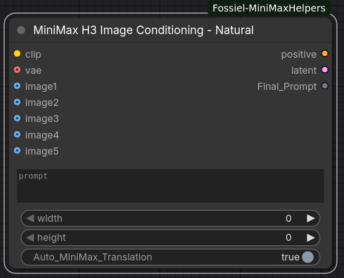
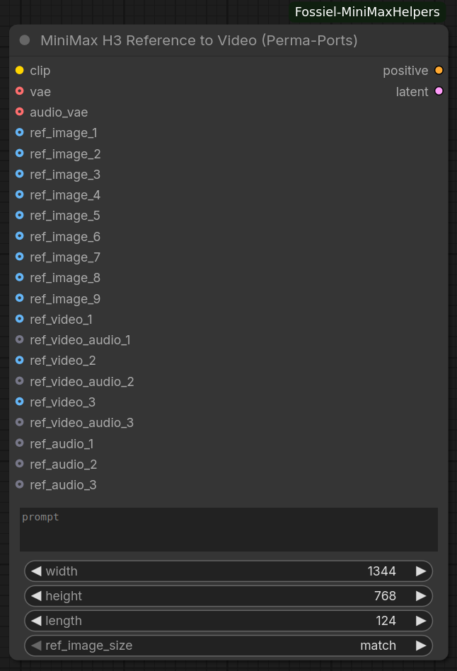
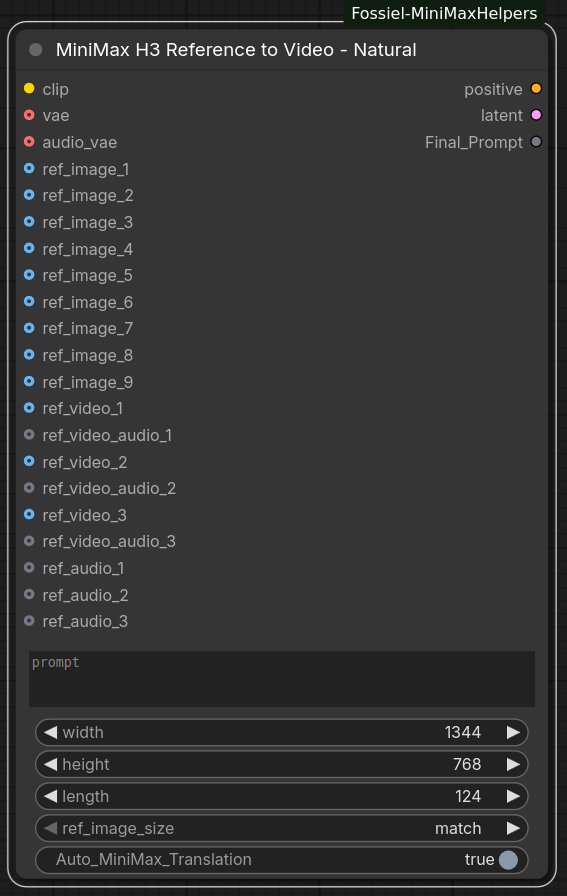
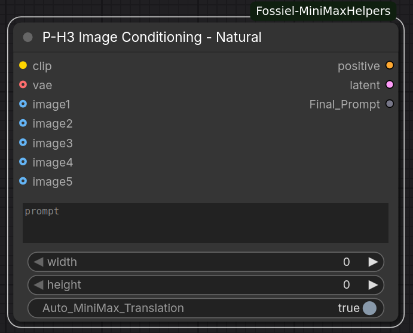

# ComfyUI-Fossiel-MiniMaxHelpers

ComfyUI-Fossiel-MiniMaxHelpers is a small suite of custom nodes designed specifically for **MiniMax H3** and **P-H3** workflows in ComfyUI.  
These nodes have been developed for personal use but maybe you’ll find them useful as well.

All nodes use the classic ComfyUI style (no `io` / schema system) and include permanent optional ports where relevant (no Autogrow).

---

## Nodes (Listed Alphabetically)

### MiniMax H3 Image Conditioning - Natural

Classic-style conditioning node for **MiniMax-H3-Image**.

- Permanent optional image ports (`image1` … `image5`)
- Optional Auto-MiniMax Translation (shorthand → official tags)
- Outputs the final prompt that was actually sent to the encoder

#### Specifications

**Required Inputs:**
1. **clip** – MiniMax-compatible CLIP / text encoder  
2. **prompt** – Text prompt (supports dynamic prompts)

**Parameters:**
1. **width** / **height** – Generation resolution (0 = auto from first image or 2048)  
2. **Auto_MiniMax_Translation** – Convert shorthand tags before encoding (default: True)

The `Auto-MiniMax-Translation` feature makes writing prompts significantly easier for people who are used to models like Qwen, Krea2 etc. Instead of working with MiniMax's `<Subject N>` format, you can write Character1 or Actress1; instead if <Picture 1> you can write image1 or img1 etc. The node will atomatically translate it to the `< >` format that MiniMax understands. In addition, you can hook up a result node such as the *Show Any* node to the `Final_Prompt` output the check that all translations have been done correctly before letting your workflow complete the generation.  

**Translation rules (when enabled):**
- `Sub1` / `Subject 1` / `Char2` / `Character 2` / `Actor3` / `Actress 3` → `<Subject N>`
- `Pic1` / `Picture 1` / `Image2` / `Img3` → `<Picture N>`
- `Vid1` / `Video 1` → `<Video N>`
- `Aud1` / `Audio 1` → `<Audio N>`  

**Optional Inputs:**
1. **vae** – MiniMax-H3-Image VAE (enables reference latents)  
2. **image1** … **image5** – Reference images

**Outputs:**
1. **positive** – Conditioning  
2. **latent** – Empty latent ready for sampling  
3. **Final_Prompt** – The prompt after translation (if enabled)  

---

### MiniMax H3 Reference to Video (Perma-Ports)

Classic ComfyUI version of the MiniMax H3 Reference-to-Video node with **permanent optional inputs** (no Autogrow).

This node prepares positive conditioning and an empty audio-visual latent for MiniMax H3 generation, using up to:

- **9** reference images  
- **3** reference videos  
- **3** paired video soundtracks  
- **3** standalone reference audios  

All optional ports are always visible, making it easy to wire complex multi-reference workflows without dynamically growing the node.

#### Specifications

**Required Inputs:**
1. **clip** – CLIP / text encoder (MiniMax-compatible)  
2. **prompt** – Text prompt (supports dynamic prompts)

**Parameters:**
1. **width** / **height** – Generation resolution (default 1344×768, step 32)  
2. **length** – Frame count at 24 fps (default 124 ≈ 5 s). Automatically snapped to the MiniMax grid (`17k + 5`)  
3. **ref_image_size**  
   - `match` – Scale reference images to the generation area (downscale only)  
   - `max` – Scale to 2048 short edge (better identity preservation, slower)

**Optional Inputs:**
1. **vae** – Video VAE (required for encoding reference images/videos into latents)  
2. **audio_vae** – Audio VAE (required for encoding reference audio)  
3. **ref_image_1 … ref_image_9** – Reference images  
4. **ref_video_1 … ref_video_3** – Reference video batches (IMAGE)  
5. **ref_video_audio_1 … ref_video_audio_3** – Optional soundtrack paired with each reference video  
6. **ref_audio_1 … ref_audio_3** – Standalone reference audios

**Outputs:**
1. **positive** – Conditioning with MiniMax reference blocks attached  
2. **latent** – Empty nested AV latent ready for sampling (video + audio)

**Notes:**
- Reference videos must contain at least 5 frames.
- Video frame counts are automatically trimmed to the nearest valid MiniMax length (… 5, 22, 39, 56, 73, 90, 107, 124 …).
- Canvas size for reference videos is adapted to stay within MiniMax’s recommended pixel budget while remaining divisible by 32.
- When a soundtrack is provided with a reference video, it is labelled and encoded before the video so the model can associate the audio correctly.
- The node does not alter the original MiniMax H3 Reference-to-Video behaviour — it only makes every reference slot permanently visible.

---

### MiniMax H3 Reference to Video - Natural

Classic ComfyUI version of the MiniMax H3 Reference-to-Video node with **permanent optional inputs** + **Auto-MiniMax Translation** + **Final_Prompt** output.

Identical functionality to the Perma-Ports version, with the following additions:

- **Auto_MiniMax_Translation** (default: True)
- **Final_Prompt** output (the prompt after translation)  

The `Auto_MiniMax_Translation` feature makes writing prompts significantly easier for people who are used to models like Qwen, Krea2 etc. Instead of working with MiniMax's `<Subject N>` format, you can write Character1 or Actress1; instead if <Picture 1> you can write image1 or img1 etc. The node will atomatically translate it to the `< >` format that MiniMax understands. In addition, you can hook up a result node such as the *Show Any* node to the `Final_Prompt` output the check that all translations have been done correctly before letting your workflow complete the generation.  

**Conservative translation rules (when enabled):**
- `Character` / `Char` / `Actor` / `Actress` → `<Subject N>`
- `Pic` / `Picture` / `Image` / `Img` → `<Picture N>`
- `Vid` / `Video` → `<Video N>`
- `Aud` / `Audio` → `<Audio N>`

(Everything else is left untouched to avoid accidental clashes.)

---

### P-H3 Image Conditioning - Natural

Classic-style conditioning node for **P-H3 Image**.

- Permanent optional image ports (`image1` … `image5`)
- Optional Auto-MiniMax Translation
- Automatically prefixes `Edit <Picture 1>. ` when images are present (unless the prompt already starts with an edit instruction)
- Outputs the final prompt that was actually sent to the encoder

#### Specifications

**Required Inputs:**
1. **clip** – P-H3-compatible CLIP / text encoder  
2. **prompt** – Text prompt (supports dynamic prompts)  

**Parameters:**
1. **width** / **height** – Generation resolution (0 = auto from first image or 2912)  
2. **Auto_MiniMax_Translation** – Convert shorthand tags before encoding (default: True)

The `Auto_MiniMax_Translation` feature makes writing prompts significantly easier for people who are used to models like Qwen, Krea2 etc. Instead of working with MiniMax's `<Subject N>` format, you can write Character1 or Actress1; instead if <Picture 1> you can write image1 or img1 etc. The node will atomatically translate it to the `< >` format that MiniMax understands. In addition, you can hook up a result node such as the *Show Any* node to the `Final_Prompt` output the check that all translations have been done correctly before letting your workflow complete the generation.  

**Optional Inputs:**
1. **vae** – P-H3 Image VAE (enables reference latents)  
2. **image1** … **image5** – Reference images

**Outputs:**
1. **positive** – Conditioning  
2. **latent** – Empty nested AV latent (still image + audio slots)  
3. **Final_Prompt** – The prompt after translation + edit prefix (if applied)

---

### Installation Instructions

1. Clone or download this repository to your local machine.  
2. Copy the repository folder to your ComfyUI custom nodes directory:  
   `ComfyUI/custom_nodes/`  
3. Restart ComfyUI to load the Fossiel MiniMax Helpers nodes.  
4. Find the nodes in ComfyUI under the categories **Fossiel/MiniMax** and **Fossiel/Conditioning**.

---

## History

2026/11/20 – Added MiniMax H3 Image Conditioning - Natural, P-H3 Image Conditioning - Natural, and MiniMax H3 Reference to Video - Natural (with translation + Final_Prompt).  
2026/10/24 – Launched with MiniMax H3 Reference to Video (Perma-Ports) node.

---

## Credits

Developed with help from Grok  

All the developers who make tools available to everyone using local AI  

Model developers for supplying fantastic open source models, free of charge.
